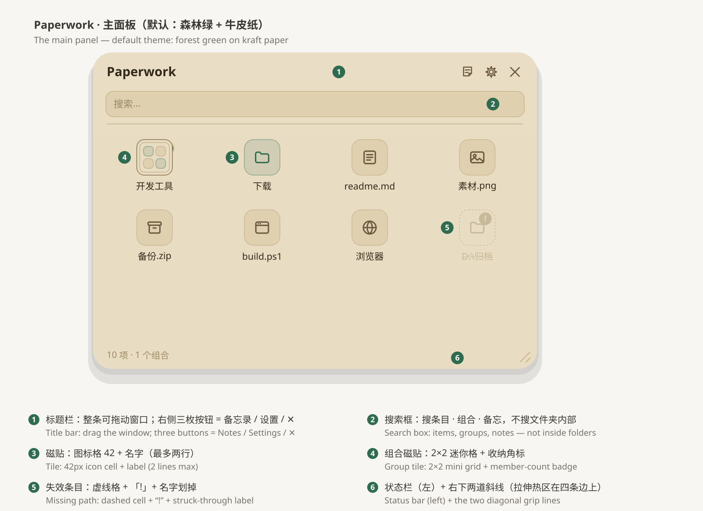
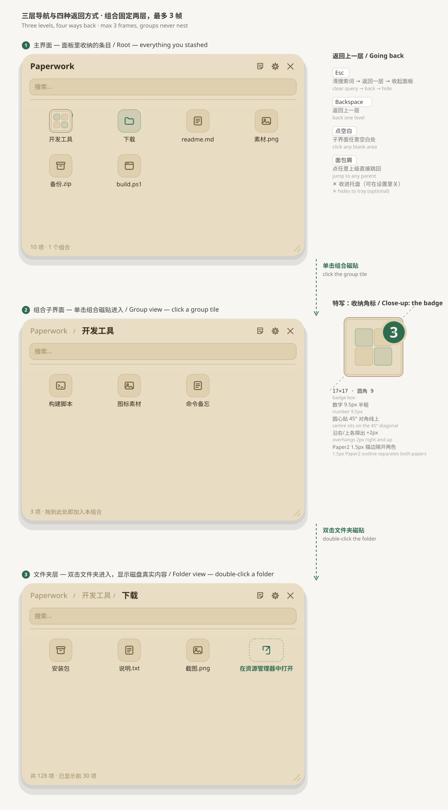
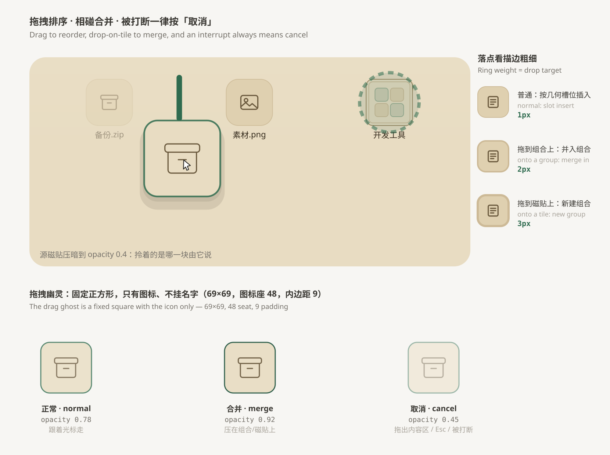
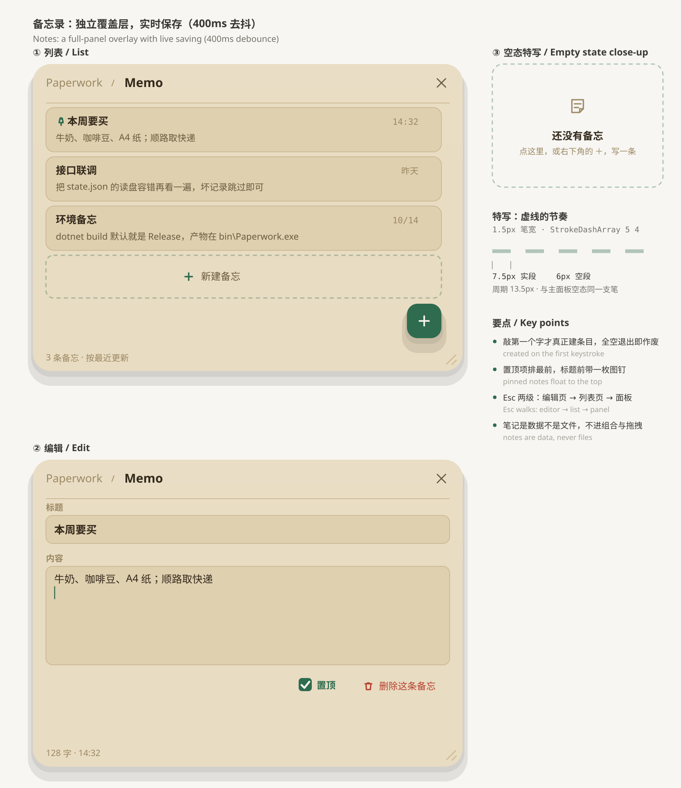
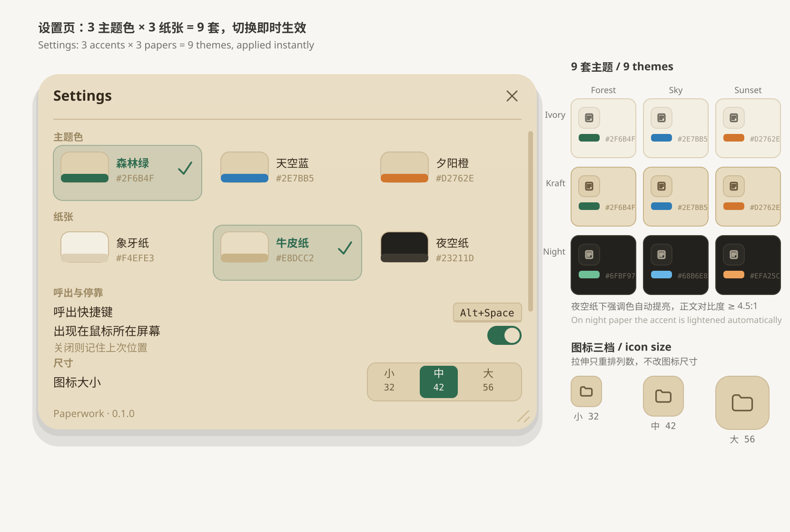
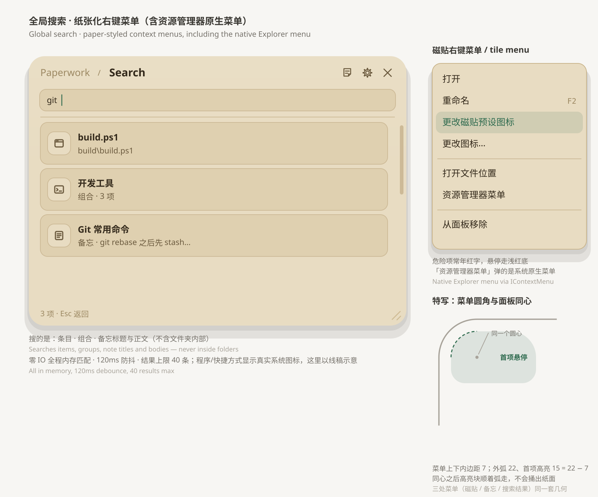

# Paperwork

**热键呼出的 Windows 收纳浮窗 —— 把快捷方式、文件、文件夹和备忘收进一块纸感面板。**<br>
A hotkey-summoned stash panel for Windows — keep shortcuts, files, folders and notes on one paper-feel panel.

`Alt+Space` 一按，面板出现在鼠标所在的位置；把任何文件拖进来，它就留在这里，下次一按还在。<br>
Press `Alt+Space` and the panel appears where your mouse is. Drop any file in, and it stays there for next time.

- 技术栈 **.NET 10 + WPF**，仅 x64，Windows 10 / 11；不内嵌任何浏览器引擎。<br>
  Built with **.NET 10 + WPF**, x64 only, Windows 10 / 11; no embedded browser engine.
- 数据就是 exe 旁边的一个 `UserData\` 文件夹，几个 JSON 文件，随程序走。<br>
  Your data is a `UserData\` folder next to the exe — a few JSON files that travel with the program.
- 单文件版双击即用（不装运行时）；框架依赖版解压后仅 4 个文件、约 0.6 MB。<br>
  The single-file build runs on a double click (no runtime install); the framework-dependent build is 4 files, about 0.6 MB.



*图 1 · 主面板。默认主题 = 森林绿 + 牛皮纸（3 主题色 × 3 纸张 = 9 套，可在设置里换）；程序与快捷方式在界面里显示各自的真实系统图标，图中统一以线稿示意。*<br>
*Figure 1 · The main panel. Default theme: forest green on kraft paper (3 accents × 3 papers = 9 themes). Programs and shortcuts show their real system icons in the app; drawn as line art here.*

---

## 这是什么 / What it is

一个**常驻托盘、热键呼出**的置顶浮窗，用来收纳你天天要点的那些东西：程序、快捷方式、文件夹、文档。<br>
A **tray-resident, hotkey-summoned** always-on-top panel for the things you click every day: programs, shortcuts, folders, documents.

它不碰你的桌面。不做桌面图标整理、不压桌面层、不接管资源管理器——面板是独立的一层，是"随手一按"的工具，不是第二个桌面。<br>
It never touches your desktop: no desktop-icon management, no desktop-layer window, no Explorer hooking. The panel is its own thing — a hotkey tool, not a second desktop.

和常见收纳工具的区别在于**手感**：拖拽排序带迟滞与落点提示、拖到组合上即合并、点空白即返回、纸张质感配 9 套主题——它把力气花在这些地方，而不是把功能清单堆长。<br>
What sets it apart is **feel**: drag-to-reorder with hysteresis and drop hints, drop-on-a-group to merge, click-blank-to-go-back, and a paper look with nine themes — the effort went into how it feels, not into a longer feature list.

---

## 呼出与收纳 / Summon and stash

- 全局热键 `Alt+Space` 呼出，面板**以鼠标位置为中心**弹出并夹回工作区；热键可改，被占用会自动退让。<br>
  Summoned with `Alt+Space`, the panel opens **centred on the mouse** and clamped to the monitor's work area; the hotkey is rebindable and steps aside if taken.
- 置顶浮窗，以工具窗口样式运行：**不占任务栏，也不进 `Alt+Tab`**；单实例——再启动一次只会把已有面板切出来。<br>
  An always-on-top tool window: **no taskbar button, no `Alt+Tab` entry**; single instance — launching again just surfaces the panel you already have.
- **任何文件、文件夹、快捷方式都能直接拖进来**。`.exe` 记录的是 exe 本体，不替你生成 `.lnk`，也不在你看不见的地方留垃圾文件。<br>
  **Drop in any file, folder or shortcut.** For an `.exe` the executable itself is recorded — no `.lnk` is created and no junk is left where you cannot see it.
- 双击磁贴打开；文件夹磁贴进入后显示**磁盘真实内容**，并在磁盘变化时自动刷新（450 ms 去抖）。<br>
  Double-click to open. A folder tile shows the **real contents of the disk** and refreshes itself when the disk changes (450 ms debounce).
- 文件夹层最多列 500 项、默认显示前 30 项，末尾一格直接开资源管理器——"下载"那种上千项的目录撑不爆面板。<br>
  A folder view lists up to 500 items, shows the first 30, and ends with a tile that opens File Explorer — directories like *Downloads* cannot blow up the panel.
- 路径失效的条目灰显、名字划掉、带「!」标记，悬停说明原因；**不自动清理**，删不删由你决定。<br>
  A tile whose path is gone dims, gets struck through and flagged with “!”, and hovering explains why. It is **never cleaned up automatically**.
- 「从面板移除」只移除条目，**磁盘文件不动**。<br>
  *Remove from panel* drops the tile only — **the file on disk is untouched**.

---

## 三层导航与四种返回 / Three levels, four ways back

主界面 → 组合 → 文件夹，**最多 3 帧**：组合不能嵌套组合，所以永远知道自己在哪、往回一定回得去。<br>
Root → group → folder, **3 frames max**: groups never nest, so you always know where you are and going back always works.



*图 2 · 三层导航、四种返回方式，以及组合角标的特写（圆角、探出量、描边都按实现画）。*<br>
*Figure 2 · Three levels, four ways back, plus a close-up of the group badge.*

- **返回**：`Esc`（先清搜索词）· `Backspace` · **点任意空白处** · 点面包屑里任意一段（直接跳回那一层）。<br>
  **Going back**: `Esc` (clears the query first) · `Backspace` · **click any blank area** · click any segment of the breadcrumb.
- 在根层点空白 = 取消选中，不会把面板关掉。<br>
  At the root level, clicking blank space just deselects — it does not close the panel.
- 已到最里一层再点文件夹，不再往下钻，改用资源管理器打开。<br>
  At the deepest frame, clicking a folder opens it in File Explorer instead of nesting further.

---

## 拖拽：排序 · 合并 · 取消 / Drag: reorder, merge, cancel

拖动磁贴就能排序；落点看**描边粗细**：1px 是普通槽位、2px 是并入组合、3px 是新建组合。<br>
Drag a tile to reorder. The drop target is told by **ring weight**: 1px = plain slot, 2px = merge into a group, 3px = create a group.



*图 3 · 拖动时源磁贴压暗、幽灵卡片跟着光标；组合中心出现命中圈，两格之间出现插入条。*<br>
*Figure 3 · While dragging: the source tile dims, a ghost card follows the cursor, the group shows a hit ring, and an insert bar appears between slots.*

- 拖到**另一个条目**的中心 → 把这两个合成一个新组合；拖到**已有组合**上 → 并进去。<br>
  Drop onto the **centre of another tile** to merge the two into a new group; drop onto **an existing group** to join it.
- **被打断一律算取消**：按 `Esc`、拖出内容区松手、面板收起、鼠标捕获被系统抢走——都还原成拖之前的顺序，不会替你提交一个没看过的结果。<br>
  **An interrupt always means cancel**: `Esc`, releasing outside the content area, the panel hiding, or the mouse capture being stolen — the previous order is restored, never a result you never saw.

---

## 备忘录 / Notes

标题栏那枚折角纸图标打开，是**独立覆盖层**：不进导航栈，重启也不会停在备忘页。<br>
Opened from the folded-paper icon in the title bar, notes are a **full-panel overlay**: not part of the navigation stack, and after a restart you are never stuck inside them.



*图 4 · 列表页、编辑页，以及空态虚线框的特写（与主面板空态同一支笔）。*<br>
*Figure 4 · The list page, the editor, and a close-up of the dashed empty state.*

- **实时保存**：每敲一个字就改内存，落盘按 400 ms 合并——没有"保存"按钮，也不用记得按。<br>
  **Live saving**: every keystroke updates memory, writing is coalesced over 400 ms — no Save button, nothing to remember.
- 敲第一个字时才真正建条目；什么都不写就退出，这条备忘不会留下。<br>
  A note is only created on the first keystroke; leave it empty and nothing is kept.
- 置顶排最前、字数与时间读数、右键可置顶/删除。<br>
  Pinning floats a note to the top; there is a character count and a timestamp, and the right-click menu can pin or delete.
- 备忘是**数据不是文件**，所以不会被拖拽排序、不会被判失效、也不进组合。<br>
  Notes are **data, not files**: they are never dragged, never marked as missing, and never live inside a group.

---

## 9 套主题 / Nine themes

3 主题色 × 3 纸张。切换**即时生效**，不重建界面，也不重启。<br>
3 accents × 3 papers. Switching is **instant** — no rebuild, no restart.



*图 5 · 设置页（这里换成夜空纸 + 天空蓝）与 9 套主题矩阵；夜空纸下强调色会自动提亮。*<br>
*Figure 5 · The settings page (here on night paper + sky blue) and the 3×3 theme matrix.*

| 主题色 / Accent | 常规 / Normal | 夜空纸 / On night paper | 性格 / Character |
|---|---|---|---|
| 森林绿 Forest | `#2F6B4F` | `#6FBF97` | 低刺激，长时间停留不刺眼<br>calm, easy to stare at |
| 天空蓝 Sky | `#2E7BB5` | `#68B6E8` | 最接近 Windows 原生强调色<br>closest to the native accent |
| 夕阳橙 Sunset | `#D2762E` | `#EFA25C` | 识别度最高，选中态最醒目<br>loudest, the most visible selection |

| 纸张 / Paper | 底色 / Base | 次级底 / Secondary | 边框 / Edge |
|---|---|---|---|
| 象牙纸 Ivory | `#F4EFE3` | `#EDE6D6` | `#DCCFB4` |
| 牛皮纸 Kraft | `#E8DCC2` | `#DFD0B0` | `#C9B48A` |
| 夜空纸 Night | `#23211D` | `#2C2A25` | `#3E3A32` |

淡底、描边、悬停色**全部由主题色算出来**（统一走 alpha），所以没有"某一页忘了跟主题"这回事；夜空纸下强调色自动提亮，保证正文对比度不低于 4.5:1。<br>
Tints and strokes are all **derived from the accent** (uniform alpha), so no page can fall out of the theme; on night paper the accent is lightened automatically to keep body contrast at or above 4.5:1.

---

## 全局搜索 / Global search

常驻面板顶部的搜索框，搜的是**条目 · 组合 · 备忘标题与正文**——不搜文件夹内部（空态里会直说）。<br>
The always-there search box searches **items · groups · note titles and bodies** — never inside folders, which the empty state says out loud.



*图 6 · 搜索结果（条目/组合/备忘分档排序）、纸张化右键菜单，以及菜单圆角与面板同心的特写；结果里的彩色条目图标同样是真实系统图标。*<br>
*Figure 6 · Search results, the paper context menu, and the menu-corner geometry close-up; the colourful result icons are real system icons too.*

- 全程**内存匹配**：一次查询几十微秒，不碰磁盘；120 ms 防抖，结果上限 40 条。<br>
  **All in memory**: tens of microseconds per query, zero disk I/O; 120 ms debounced, 40 results max.
- 排序先分档（条目 → 组合 → 备忘），再按匹配分数降序：完全相等 → 前缀 → 词首 → 其余。<br>
  Results are ranked by kind (items → groups → notes) and then by match score: exact → prefix → word start → anywhere.
- 结果可以直接打开、打开文件位置，或弹资源管理器原生菜单。<br>
  From a result you can open it, reveal its location, or pop the native Explorer menu.

---

## 与资源管理器一致 / Explorer-consistent

磁贴右键菜单是**纸张化**的（和面板同一套圆角与配色），其中「资源管理器菜单」弹出的是**系统原生菜单**——复制、发送到、属性、第三方软件塞进去的项，一个都不少。<br>
The tile menu is **paper-styled** (same corners and palette as the panel), and its *File Explorer menu* entry pops the **real native menu** — Copy, Send to, Properties, and whatever third-party software added, all included.

- 菜单几何与危险色统一：外弧 22、首项高亮 15（= 22 − 7）同心；「从面板移除 / 删除」走危险红。<br>
  Menu geometry is uniform: outer radius 22, first-item highlight 15 (= 22 − 7), concentric; destructive entries use danger red.
- 条目还能「以管理员身份运行」，或挑一个图标文件（`.ico` / `.exe` / `.dll`）换掉磁贴图标。<br>
  Items can also be *run as administrator*, or given a custom icon file (`.ico` / `.exe` / `.dll`).

---

## 图标 / Icons

图标是**三层**，上面一层盖住下面一层：<br>
Icons form **three layers**, each covering the one below:

1. **预设图标**：内置 60 个线稿分类图标（游戏、创作、开发、系统网络、金融生活…共 7 个分区），风格统一、跟随主题色。<br>
   **Preset icons**: 60 built-in line-art icons across 7 zones, uniformly drawn and following the accent colour.
2. **自定义图标文件**：右键「更改图标…」挑一个 `.ico` / `.exe` / `.dll`。<br>
   **A custom icon file**: *Change icon…* lets you pick a `.ico` / `.exe` / `.dll`.
3. **磁贴自己的图标**：程序与快捷方式显示真实系统图标，其它文件按类型给线稿，文件夹给文件夹图形。<br>
   **The tile's own icon**: programs and shortcuts show the real system icon, other files get a type glyph, folders get a folder glyph.

「恢复默认图标」一次清掉上面两层；图标大小有 **32 / 42 / 56** 三档，拉伸窗口只会重排列数、不会把图标拉大缩小。<br>
*Restore default icon* clears the top two layers at once. Icon size comes in **32 / 42 / 56**, and resizing the window only reflows columns — it never rescales icons.

---

## 使用小贴士 / Tips

- **默认热键是 `Alt+Space`**（可在设置里改）。热键被别的程序占用时会自动退让到候选键位，并在托盘气泡里告诉你换成了哪个。<br>
  **The default hotkey is `Alt+Space`** (changeable in Settings). If it is taken, Paperwork falls back to a candidate chord and tells you which one via a tray balloon.
- 面板**以鼠标位置为中心**弹出，并夹回所在显示器的工作区——手不用移回去，光标贴边时也不会飞出去。<br>
  The panel opens **centred on the mouse** and is clamped to that monitor's work area, so your hand never travels and it never flies off screen.
- 在组合或文件夹里，**点任意空白处就回上一层**；在根层点空白只是取消选中。<br>
  In a group or folder view, **clicking any blank area goes back one level**; at the root it just deselects.
- `Esc` 是一条三级链：清搜索词 → 返回上一层 → 收起面板；`Backspace` 也是返回。<br>
  `Esc` walks a three-step chain: clear the query → back one level → hide the panel. `Backspace` also goes back.
- **按住空白上下拖**是滚动，松手带惯性；滚轮也能滚，但滚轮会打断惯性。<br>
  **Press and drag on blank space** to scroll, with inertia after release; the wheel scrolls too and cancels that inertia.
- 把条目拖到**组合图标中心**就并进去；两个条目中心相碰就新建一个组合。<br>
  Drop onto a **group's centre** to join it; drop one tile onto another's centre to create a new group.
- 拖出内容区松手 / 按 `Esc` / 面板被打断 = 这一次拖拽**取消**，顺序还原。<br>
  Releasing outside the content area, pressing `Esc`, or any interruption **cancels** the drag and restores the order.
- 文件夹层显示的是**磁盘真实内容**，所以不接受拖入——状态栏会说明去哪儿放。<br>
  The folder view shows **real disk contents**, so it refuses drops — the status bar tells you where to drop instead.
- 从面板移除**只移除条目，磁盘文件不会被删**（状态栏也会这么写）。<br>
  Removing from the panel **only removes the tile — the file on disk is untouched** (the status bar says so too).
- 路径失效的条目会灰显 + 划掉 + 「!」标记，悬停告诉你原因；**它不会自动清理**，要不要删由你决定。<br>
  A tile whose path is gone dims, gets struck through and flagged with “!”, and hovering explains why. It is **never cleaned up automatically** — that is your call.
- 备忘**实时保存**，不用点保存；关面板 / 退出时会强制写盘。<br>
  Notes **save live**; there is no save button, and hiding or quitting flushes to disk.
- 点 **✕** 默认是收进托盘而不是退出（`Alt+F4` 同理），想直接退出就用托盘右键里的「退出」——这个默认值可以在设置里关掉。<br>
  **✕** hides to the tray rather than quitting (`Alt+F4` too); use *Exit* in the tray menu to really quit. That default can be turned off in Settings.
- 首次启动时，「行为」那四项默认全部打开：**跟随系统启动**、**点 ✕ 收托盘**、**组合角标**、**全屏应用时自动收起**（游戏、视频全屏时让位）。四项都能在设置里关掉。<br>
  On first run all four Behaviour switches start on: **start with Windows**, **✕ hides to tray**, **group badge**, and **auto-hide when an app goes full screen**. All four can be turned off in Settings.

---

## 交互速查 / Cheat sheet

| 操作 / Action | 结果 / Result |
|---|---|
| `Alt+Space` | 呼出 / 收起面板<br>show / hide the panel |
| 拖动磁贴<br>drag a tile | 排序 · 并入组合 · 新建组合<br>reorder · merge into a group · create a group |
| 双击磁贴<br>double-click a tile | 打开文件，或进入文件夹<br>open the file, or enter the folder |
| 单击组合磁贴<br>click a group tile | 进入组合<br>enter the group |
| 在空白处单击<br>click blank space | 返回上一层（根层则取消选中）<br>back one level (deselect at the root) |
| `Esc` | 清搜索词 → 返回上一层 → 收起面板<br>clear query → back → hide |
| `Backspace` | 返回上一层<br>back one level |
| 点面包屑任意一段<br>click a breadcrumb segment | 直接跳回那一层<br>jump straight to that level |
| 右键磁贴<br>right-click a tile | 纸张化菜单，含资源管理器原生菜单<br>paper menu, including the native Explorer menu |
| 滚轮 / 按住空白上下拖<br>wheel / drag blank vertically | 滚动（后者带惯性）<br>scroll (the latter has inertia) |
| 拖到面板外松手<br>release outside the panel | 取消这次拖拽<br>cancel the drag |
| `✕` | 收进托盘（默认）<br>hide to tray (default) |

---

## 安装与运行 / Install and run

| 产物 / Artifact | 大小 / Size | 需要什么 / Needs |
|---|---|---|
| `Paperwork-CN-0.1.0.exe`（中文界面）<br>Chinese UI build | ≈ 66 MB | 双击即用，自带 .NET 运行时<br>double-click, .NET runtime included |
| `Paperwork-EN-0.1.0.exe`（英文界面）<br>English UI build | ≈ 66 MB | 同上<br>same as above |
| `Paperwork-v0.1.0-portable.zip` | ≈ 230 KB | 解压后 4 个文件（约 0.6 MB），需要 **.NET 10 桌面运行时**<br>4 files (~0.6 MB) after unzipping; needs the **.NET 10 Desktop Runtime** |

推荐使用`.exe`程序，这样不需要单独下载.net10桌面运行时
I recommend using the `.exe` build — that way you don't need to download the .NET 10 Desktop Runtime.

- 仅 x64，Windows 10 / 11。
**x64** only, Windows 10 / 11.

 .NET 10 桌面运行时可以访问微软官网或下述官方链接下载：
The .NET 10 Desktop Runtime can be downloaded from the Microsoft official website or via the official link below:

https://dotnet.microsoft.com/en-us/download/dotnet

- 中英是**两套编译产物**（界面文案是编译期常量，不是运行时切换）——想要另一种界面就换那个 exe。<br>
  Chinese and English are **two separate builds** (UI strings are compile-time constants, not a runtime switch) — pick the exe you want.
  
- ⚠️ **不要用管理员身份运行**。Windows 的 UIPI 会阻断资源管理器向提权进程拖放文件，而"把文件拖进来"是它的核心功能；程序检测到自己被提权时会弹托盘气泡提醒你。<br>
  ⚠️ **Do not run it as administrator.** Windows UIPI blocks drag-and-drop from Explorer into an elevated process, which breaks the core feature. Paperwork notices elevation and warns you via a tray balloon.
  
- 从托盘右键「退出」才是真的退出；卸载就是删掉 exe（和你想留就留的 `UserData\`）。<br>
  Only *Exit* in the tray menu really quits. Uninstalling means deleting the exe (and the `UserData\` folder, if you want it gone).

---

## 数据与隐私 / Data and privacy

- 数据放在 **exe 同级的 `UserData\`**（写不进去才回退到 `%APPDATA%\Paperwork`），所以放在 U 盘里的副本会把数据一起带走。<br>
  Data lives in a **`UserData\` folder next to the exe** (falling back to `%APPDATA%\Paperwork` if that is not writable), so a copy on a USB stick takes its data along.
- `state.json`（条目 / 组合 / 备忘 / 设置 / 上次所在层）· `window.json`（窗口几何）· `error.log`（出错时才写）。<br>
  `state.json` (items / groups / notes / settings / last level) · `window.json` (window geometry) · `error.log` (only written on errors).
- 落盘是**原子写**：先写临时文件，再替换主文件并把上一版留成 `.bak`。<br>
  Saving is **atomic**: write a temp file, replace the main file, keep the previous version as `.bak`.
- 读坏了也不静默回滚：主文件读不出来就用备份（并弹气泡说明）；两个都坏就把坏文件另存为 `state.json.corrupt-<时间戳>` 后按空面板启动；单条脏记录**逐条跳过**并报告条数，不会因为一条坏数据把整份丢掉。<br>
  Corrupt data never rolls back silently: if the main file is unreadable the backup is used (with a balloon explaining it); if both fail, the broken file is kept as `state.json.corrupt-<timestamp>` and the app starts empty; individual bad records are **skipped one by one** and reported, so one bad row never costs you the whole file.
- **不联网**。没有任何遥测、账号或云端；备份就是复制那个文件夹。<br>
  **No network access.** No telemetry, no accounts, no cloud; backing up means copying that folder.

---

## 边界：它不做什么 / Scope: what it does not do

- **不是桌面图标管理器**。它不读桌面目录、不隐藏桌面图标、不把窗口压到桌面层——面板是热键呼出的独立浮窗，不是第二个桌面。<br>
  **It is not a desktop-icon manager.** It does not read the desktop folder, hide desktop icons, or sink a window into the desktop layer. The panel is a hotkey-summoned window of its own.
- **组合固定两层**，组合里不能再放组合。换来的是"往回一定回得去"。<br>
  **Groups are two levels deep, always** — a group cannot contain a group. In exchange, going back always works.
- **文件夹层不接受拖入**（显示的是磁盘内容，不是面板数据），会明确拒绝并提示。<br>
  **The folder view refuses drops** (it shows disk contents, not panel data) and says so.
- 文件夹层**最多列 500 项、默认显示前 30 项**，末尾放一个「在资源管理器中打开」的出口。<br>
  A folder view lists **up to 500 items and shows the first 30**, ending with an *Open in File Explorer* tile.
- **失效条目不会自动清理**，只灰显。避免误删"U 盘刚拔下来"的条目。<br>
  **Missing paths are never auto-cleaned**, only dimmed — so unplugging a USB stick cannot cost you tiles.
- **超长路径（> 260 字符）只放宽判定，不做完整支持**：这种路径不会被误判成"已删除"，但取不到系统图标与显示名。<br>
  **Very long paths (> 260 chars) are tolerated, not fully supported**: they are no longer mis-flagged as missing, but they get neither the system icon nor the shell display name.
- **没有运行时语言切换**：中英是两套 exe。<br>
  **No runtime language switching**: Chinese and English are two builds.
- 搜索**不含文件夹内部**。<br>
  Search **never looks inside folders**.

---

## 代码结构 / Layout

```
src/Paperwork/
├─ App.xaml.cs                 启动顺序：单实例 → 建窗 → 托盘 → 热键 / startup order, crash logging
├─ Shell/                      面板与交互，按功能拆文件 / the panel and interactions, per feature
│  ├─ PanelWindow.xaml(.cs)    面板骨架、导航、右键菜单、拖放入口 / shell, navigation, menus, drop
│  ├─ PanelWindow.Search.cs    全局搜索 / global search
│  ├─ PanelWindow.Memo.cs      备忘录：列表 + 编辑 / notes: list and editor
│  ├─ PanelWindow.Settings.cs  设置页与改键捕获 / settings and hotkey capture
│  ├─ PanelWindow.Picker.cs    60 个预设图标的挑选页 / the 60-icon picker
│  ├─ PanelWindow.Reorder.cs   拖拽排序、相碰合并、幽灵窗口 / reorder, merge, drag ghost
│  ├─ Native*.cs, ShellIcons   原生菜单与取图标 / native Explorer menu, icons, display names
│  └─ DragGhost, PanScroll     幽灵卡片、带惯性的滚动 / ghost card, inertial scrolling
├─ Data/                       数据模型、状态存储（原子写/备份/迁移）、图标族、监听、搜索
│                              models, atomic state store, glyphs, folder watching, search
├─ Themes/Palette.cs           9 套主题的派生规则 / accent and paper derivation
├─ Hotkeys/                    全局热键与改键校验 / global hotkey and chord validation
├─ Tray/                       托盘图标与纸张化托盘菜单 / tray icon and paper tray menu
├─ Lifecycle/                  单实例、开机自启、窗口几何持久化 / single instance, autorun, geometry
└─ docs/assets/readme/         本文配图（手绘 SVG，非截图） / the figures in this README
```

*本 README 里的 6 张图都是按程序实际的色值、圆角、字号与文案手绘的 SVG，不是截图。*<br>
*All six figures in this README are hand-drawn SVGs using the program's actual colours, radii, type sizes and wording — not screenshots.*
